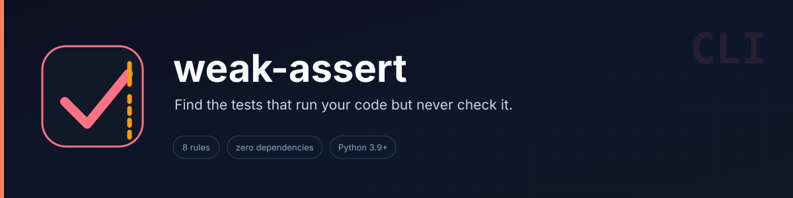
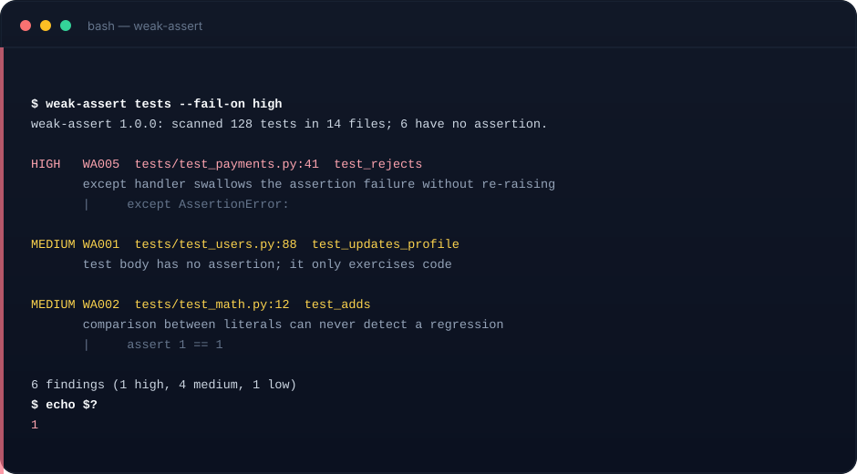

# weak-assert

**Find the tests that run your code but never really check it.**



A zero-dependency Python CLI that audits pytest / unittest suites with the
standard-library AST. It reports assertions that cannot fail, tests with no
assertion at all, swallowed assertion failures, and skipped tests that do not
say why.

[](https://github.com/muguang1224/weak-assert/actions/workflows/ci.yml)
[](LICENSE)
[](https://www.python.org/)

> Agent Skill: [`SKILL.md`](SKILL.md) · CLI: `scripts/weak_assert.py` · Tests: 61



## Why

Coverage answers "did this line run?". It does not answer "did anything check
the result?". A suite can hit 100% coverage with assertions that always pass:

```python
def test_parse():
    assert 1 == 1                 # WA002 constant assertion
    assert result                 # WA003 bare truthiness
    try:
        assert parse("") == 0
    except AssertionError:
        pass                      # WA005 swallowed failure
```

`weak-assert` turns those into line-addressable findings you can triage or gate
in CI. It never runs the tests, never edits your files, and never decides that a
test is "good".

## Quick start

```bash
python3 scripts/weak_assert.py tests
python3 scripts/weak_assert.py tests --fail-on high
python3 scripts/weak_assert.py tests --json weak-assert.json --md weak-assert.md
python3 scripts/weak_assert.py --list-rules
```

Exit codes: `0` clean (or below `--fail-on`), `1` findings at or above the
threshold, `2` usage / unreadable path / unwritable report.

## Rules

| Rule | Severity | Detects |
| --- | --- | --- |
| WA001 | medium | test body contains no assertion |
| WA002 | medium | assertion on a literal or identical literals |
| WA003 | low | bare truthiness assertion (`assert x`, `assert not x`) |
| WA004 | medium | expected exception is `Exception` / `BaseException` |
| WA005 | high | `try` around an assertion with a handler that cannot re-raise |
| WA006 | high | comparison of a value with itself (`x == x`) |
| WA007 | medium | assertion after an unconditional `return` / `raise` |
| WA008 | low | skip / xfail decorator without a reason |

## Reading the report

```
weak-assert 1.0.0: scanned 61 tests in 1 files; 0 have no assertion.

HIGH   WA005  tests/test_parse.py:14  test_rejects
       except handler swallows the assertion failure without re-raising
       | except AssertionError:

3 findings (1 high, 1 medium, 1 low)
```

`WA001` is the headline number. `WA005` is the one that hides real failures.
`WA003` is a nudge, not a bug — compare against the expected value when the
value has more structure than truthiness.

## Suppression

```python
def test_legacy():  # weak-assert: ignore=WA003
    assert result

# weak-assert: ignore-file
```

`# weak-assert: ignore` without a rule suppresses every rule on that line.
The file marker only works when it appears in a comment, never inside a string.

## What it does not do

- It does not execute tests, measure coverage, or read `.coverage` data.
- It cannot see assertions inside helper functions (`check_equal(a, b)`).
- It only understands Python (pytest and unittest). There is no JS/TS scanner.
- It does not rewrite code. Every fix is a manual decision.
- It is not a style guide: `assertTrue(result)` is intentionally not flagged.

## CI

```yaml
- name: Assertion quality
  run: python3 scripts/weak_assert.py tests --fail-on high
```

The included workflow runs the test suite on Python 3.9–3.12 and dogfoods the
tool against its own tests.

## Tests

```bash
python3 -m unittest discover -s tests -v
```

61 tests cover every rule, suppression semantics, skip discovery, encoding
edge cases (BOM, NUL bytes), report formats, and exit codes.

## Layout

```
SKILL.md               Agent Skill instructions
scripts/weak_assert.py the whole tool
tests/                 unittest suite
assets/                banner + terminal demo
.github/workflows/     CI
```

## 中文简介

`weak-assert` 是一个零依赖的 Python 测试质量审计工具。它用标准库 AST 扫描
pytest / unittest，找出"跑了代码但什么都没验证"的测试：没有断言、断言常量、
自己和自己比较、异常被 `try/except` 吞掉、`return` 之后的死断言、没有理由的
skip。输出带文件与行号的报告，可用 `--fail-on` 接入 CI。它不执行测试、不测量
覆盖率、不改代码；JavaScript / TypeScript 暂不支持。

MIT © 2026 muguang1224
